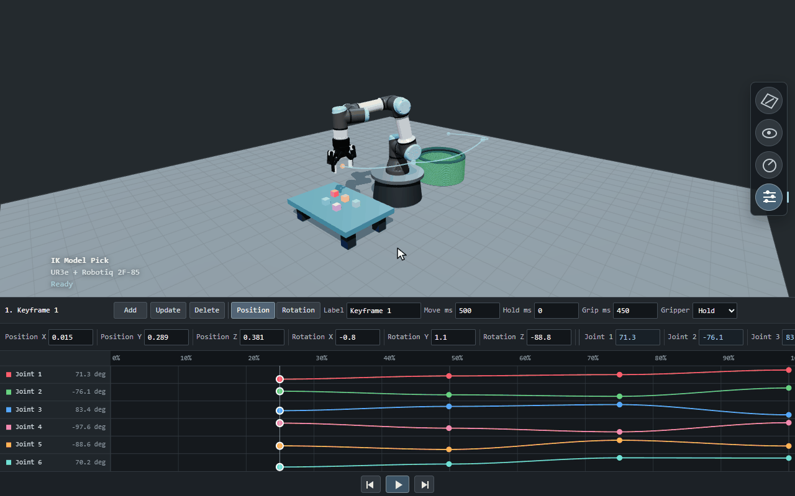
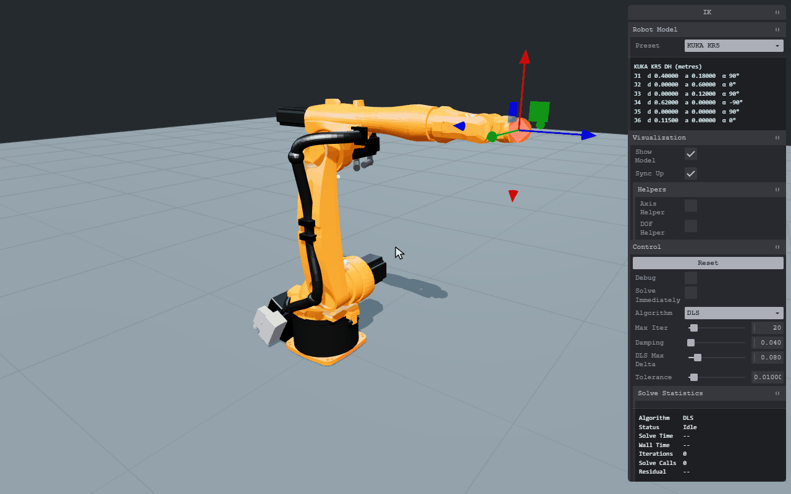
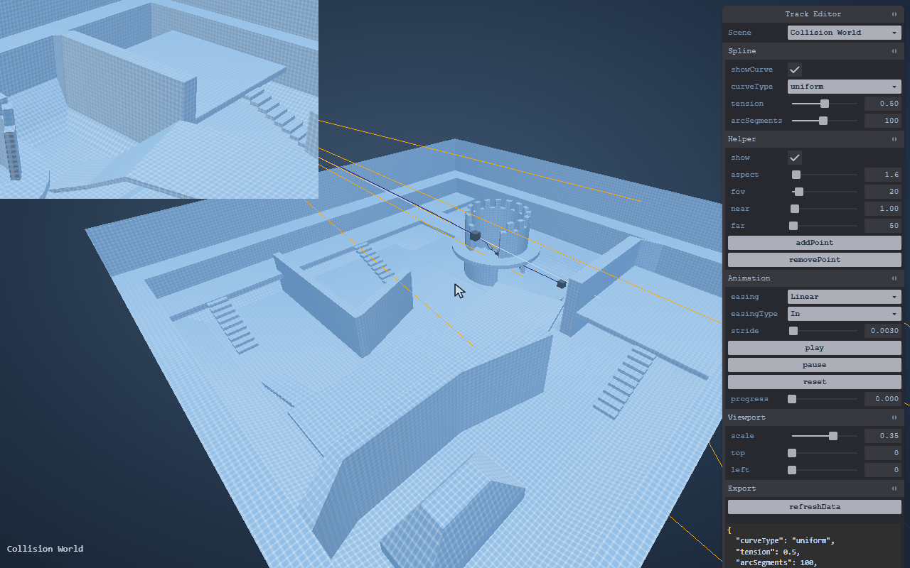
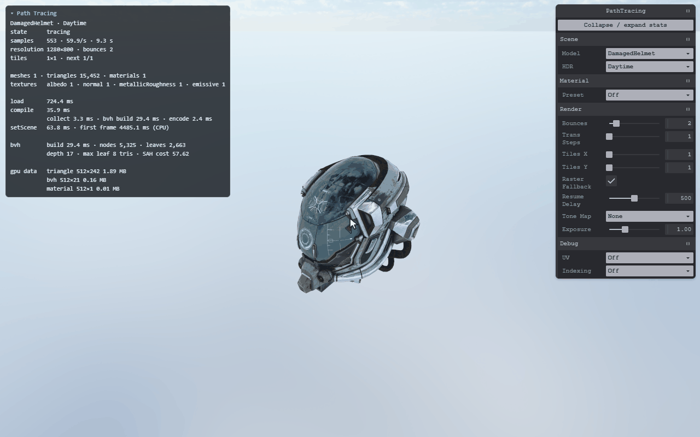
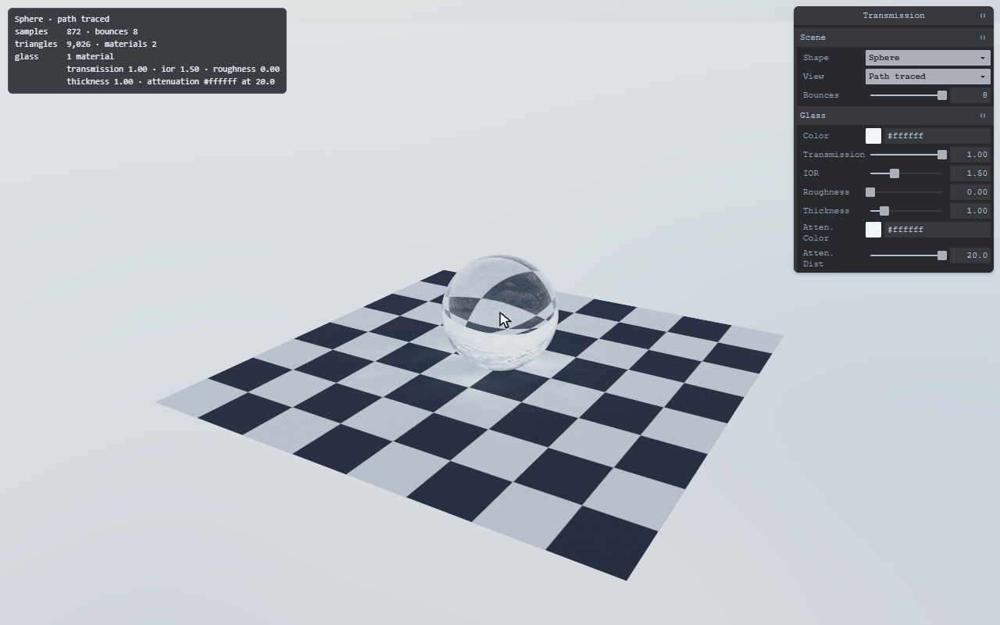
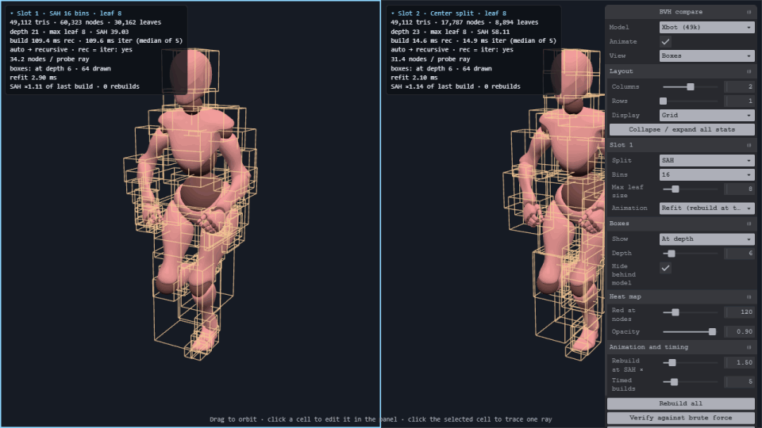
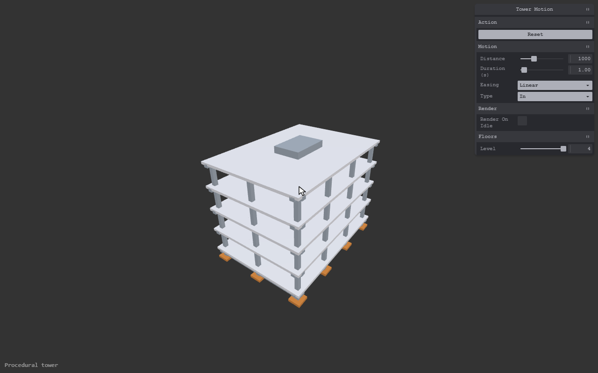
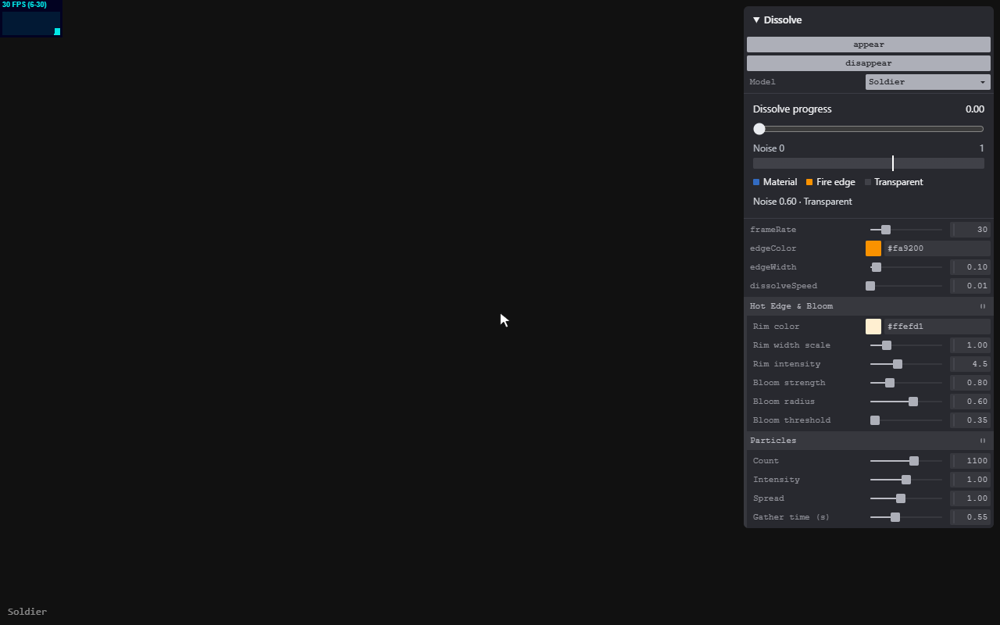

# three-chamber

A collection of Three.js experiments, from robot kinematics and camera tooling
to physically based rendering and shader effects.

Each demo in `examples/` is a single page. The reusable parts behind them live
in `extend/`: kinematic solvers and robot rigs, motion controllers, a WebGL
path tracer, and a typed-array BVH that can refit animated geometry. The
demos are kept as small, readable prototypes rather than production systems.

Recent examples are built with AI coding agents (Codex and Claude). The
conventions they follow are in
[.agent](https://github.com/wwjll/three-chamber/blob/main/.agent/README.md).

[Change Log](https://github.com/wwjll/three-chamber/blob/main/docs/changes/README.md)

# How to run

```shell
pnpm run start
```

Static asset server runs on port `2000` by default.
If assets fail to load, check whether the asset server is running and whether port `2000` is reachable.

# My Blog

Find more in my blog : [juejin](https://juejin.cn/user/46634010687316/posts)

# Featured Projects

# Kinematic and Robotic

-   **IK Model Pick**

    UR3e + Robotiq pick-and-place demo with recorded full-chain keyframes, configurable orientation constraints, DLS IK, staged motion, and physics-based cube grasp/release.

    [Preview](https://wwjll.github.io/three-chamber/ikModelPick.html)

    

-   **Simple IK**

    Position-target IK demo with draggable end-effector control, selectable DLS/basic IK, and convergence statistics.
    Supports KUKA KR5 and UR3e robot profiles with procedural or loaded model visualization.

    [Preview](https://wwjll.github.io/three-chamber/ik.html)

    

# Editors

-   **Camera Editor**

    Spline-based camera animation editor for smooth, programmable shots

    [Preview](https://wwjll.github.io/three-chamber/cameraEditor.html)

    

# Rendering

-   **Path-Tracing**

    A path-tracing demo built on Three.js.

    [Preview](https://wwjll.github.io/three-chamber/pathTracing.html)

    

-   **Path Tracing Transmission**

    Test bed for glass and other transmissive materials in the path tracer.
    A sphere and a prism on a checker floor make refraction easy to read, and the DragonAttenuation model adds coloured volume absorption through `KHR_materials_transmission` and `KHR_materials_volume`.
    The panel edits color, IOR, thickness and attenuation, and a raster view renders the same scene with three.js transmission as a reference.

    [Preview](https://wwjll.github.io/three-chamber/pathTracingTransmission.html)

    

-   **BVH Compare**

    Side-by-side comparison of BVH build settings on the same model: SAH or center splits, bin counts, and leaf sizes, in a grid of up to 3×3 views.
    Shows bounding boxes level by level, a traversal-cost heat map, single-ray picks, and refit versus rebuild while the model animates.
    Builds run in Web Workers on the reusable typed-array BVH in `extend/partition`.
    The BVH draws on ideas from [three-mesh-bvh](https://github.com/gkjohnson/three-mesh-bvh) by Garrett Johnson.

    [Preview](https://wwjll.github.io/three-chamber/bvhCompare.html)

    

# Animation

-   **TowerMotion**

    Lightweight BIM building animation controller with timeline-friendly motion

    [Preview](https://wwjll.github.io/three-chamber/towerMotion.html)

    
    
# Visual Effects

-   **Dissolve**

    Custom dissolve shader driven by Three.js onBeforeCompile for art-directed fades

    [Preview](https://wwjll.github.io/three-chamber/dissolve.html)

    
